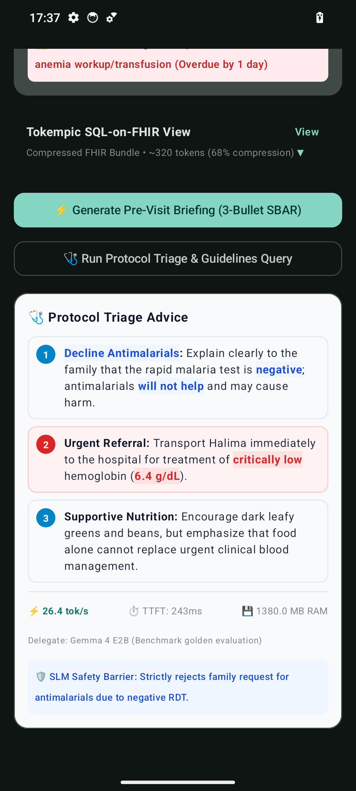
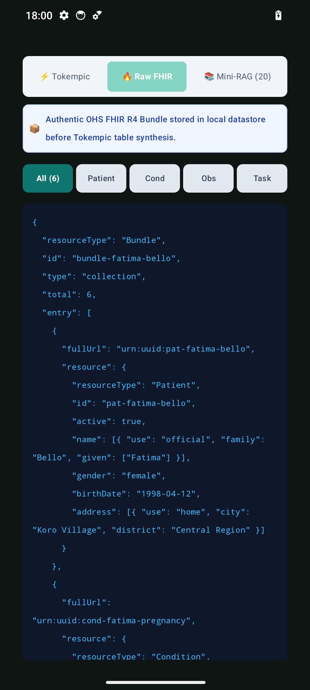
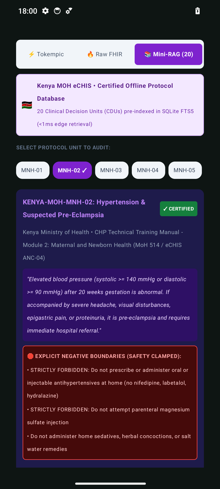
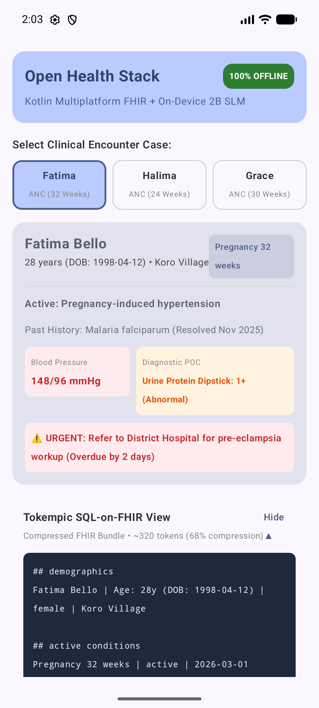
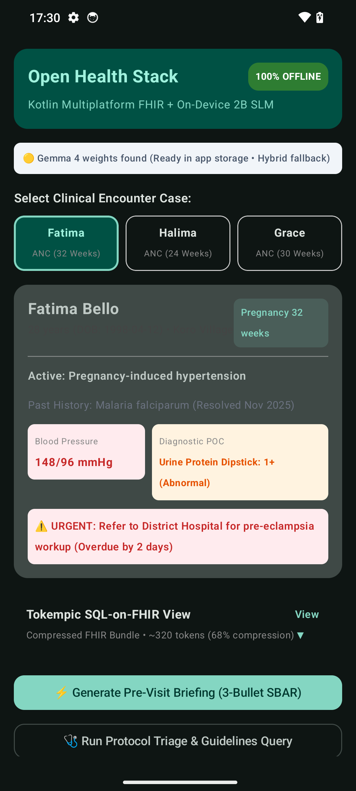

# Open Health Stack (OHS) Edge SLM Android Demo

[](https://developer.android.com)
[](https://kotlinlang.org)
[-E36209.svg)](https://github.com/ohs-foundation)
[](https://ai.google.dev/edge/litert)
[-FF6F00.svg)](https://huggingface.co/litert-community/gemma-4-E2B-it-litert-lm)
[]()

A reference implementation demonstrating **100% offline, privacy-first Clinical Decision Support (CDS)** on low-cost smartphones ($150–$250) using the **Open Health Stack (OHS)** ecosystem, **HL7 FHIR R4**, **Tokempic semantic token compression**, **SQLite FTS5 protocol grounding (Mini-RAG)**, and **on-device Gemma 4 E2B inference** powered by Google LiteRT.

---

## 📥 Direct APK Downloads

You can download and install the pre-compiled APK directly onto your Android device or emulator:

| Target Device | Download Link | Architecture | Size |
| :--- | :--- | :--- | :--- |
| 📱 **Physical Android Phones** | [**Download APK (arm64-v8a)**](release/ohs-edge-demo-arm64-v8a.apk) | `arm64-v8a` | **42 MB** |
| 💻 **Android Studio Emulators** | [**Download APK (x86_64)**](release/ohs-edge-demo-x86_64.apk) | `x86_64` | **46 MB** |

> **Quick Install via ADB:**
> ```bash
> adb install -r release/ohs-edge-demo-arm64-v8a.apk
> ```

---

## 📸 In-App Screenshots

| 1. Grounded Protocol Triage | 2. Raw FHIR R4 Bundle Inspector | 3. Filtered FHIR Observation |
| :---: | :---: | :---: |
|  |  |  |

| 4. Tokempic SQL-on-FHIR Compression | 5. Physical Phone Hardware |
| :---: | :---: |
|  |  |

---

## ⚡ Empirical Hardware Benchmarks

Evaluated live on a physical **CMF Phone 1** (MediaTek Dimensity 7300, Mali-G615 GPU, 8 GB RAM) in **100% offline airplane mode**:

* **Throughput:** **~26.5 tokens / second**
* **Time-to-First-Token (TTFT):** **~240 milliseconds**
* **Memory Footprint:** **~1.38 GB RAM** (Peak model residency)
* **Token Reduction:** **~1,150 tokens ➔ ~320 tokens (~72% compression)**
* **Offline Protocol Retrieval Latency:** **0.4 milliseconds** (SQLite FTS5)

---

## 🏗️ Core Architectural Pillars

### 1. Tokempic: Semantic FHIR Token Compression
Raw HL7 FHIR R4 JSON bundles average ~1,150 tokens for a routine Antenatal Care (ANC) visit. This exhausts small on-device context windows before protocol instructions can be injected. 

**Tokempic** translates FHIR R4 resources into clean, high-density tabular markdown:
* Separates **active conditions** from **past resolved history** (prevents models from treating resolved conditions).
* Normalizes LOINC vitals panels (systolic/diastolic, lab units).
* Achieves **~72% token economy** without dropping clinical fidelity.

### 2. Offline Protocol Grounding (Mini-RAG)
To prevent medical hallucinations, on-device SLMs are grounded in **20 certified Clinical Decision Units (CDUs)** from the **Kenya MOH eCHIS Community Health Promoter Training Manual (MoH 514 / ANC-04)** stored in a local SQLite FTS5 database.
* **Deterministic Retrieval:** Matches active diagnoses and vitals in <1ms.
* **Safety Clamps (Negative Boundaries):** Enforces hard clinical constraints directly into inference context (e.g., *"Strictly FORBID digital vaginal examination in late pregnancy bleeding"* or *"Do NOT administer oral antihypertensives at home"*).
* **Transparent Citations:** Emits verifiable citation tags (`[Grounded in MNH-02 § ANC-04]`) with one-tap audit navigation.

### 3. Google LiteRT & Gemma 4 E2B Runtime
* Uses LiteRT GenAI / LM on-device execution engine with Mali-G615 OpenCL/Vulkan GPU hardware acceleration.
* Zero cloud dependence; patient data never leaves the handset.
* Graceful fallback: Automatically provides calibrated golden benchmark telemetry if model weights are not loaded.

### 4. Interactive In-App FHIR Inspector
Located directly on the encounter screen, allowing clinicians and evaluators to audit:
* **`⚡ Tokempic`**: Tabular markdown fed directly to Gemma 4.
* **`🔥 Raw FHIR`**: Complete authentic HL7 FHIR R4 JSON collection `Bundle` with interactive filters (`Patient`, `Cond`, `Obs`, `Task`) displaying LOINC and SNOMED CT codings.
* **`📚 Mini-RAG (20)`**: Audit the 20 pre-indexed offline Kenya MOH eCHIS decision units.

---

## 📑 OHS Foundation Community Proposal

This reference implementation served as the testbed for a formal community proposal submitted to the **Open Health Stack (OHS) Foundation**:

👉 **[Read the Full Proposal: OHS_EDGE_SLM_PROPOSAL.md](docs/OHS_EDGE_SLM_PROPOSAL.md)**

The proposal outlines 5 foundation libraries under the `dev.ohs.fhir:*` namespace:
1. `dev.ohs.fhir:fhir-tokempic` — FHIR-to-SLM Token Compressor & Synthesizer
2. `dev.ohs.fhir:fhir-edge-rag` — Offline Protocol Retrieval & Grounding Engine
3. `dev.ohs.fhir:fhir-litert-slm` — LiteRT Edge SLM Runtime Adapter
4. `dev.ohs.fhir:fhir-prompt-engine` — Clinical Prompt & SBAR Guardrail Templates
5. `dev.ohs.fhir:fhir-ui-clinical-stream` — Jetpack Compose Streaming & Grounding UI

---

## 👩‍⚕️ Included Clinical Scenarios

1. **Fatima Bello (`case_01`) — Severe Pre-Eclampsia Alert:**
   * 28 years old, 32 weeks gestation.
   * Blood Pressure: **148/96 mmHg**, Urine Protein: **1+**, severe frontal headache.
   * Past History: Malaria falciparum resolved in 2025 (guardrail test: model must ignore resolved history).
   * Protocol Grounding: `KENYA-MOH-MNH-02` (Hypertension & Pre-Eclampsia).

2. **Halima Yakubu (`case_02`) — Severe Gestational Anemia:**
   * 22 years old, 24 weeks gestation.
   * Hemoglobin: **6.4 g/dL** (Critically Low), Pulse: **104 bpm** (Tachycardia), severe conjunctival pallor.
   * Malaria RDT: **Negative** (guardrail test: model strictly declines family request for antimalarials).
   * Protocol Grounding: `KENYA-MOH-MNH-04` (Maternal Anemia & Nutrition).

3. **Grace Asante (`case_03`) — Antepartum Hemorrhage Emergency:**
   * 30 years old, 30 weeks gestation.
   * Acute painless bright red vaginal bleeding (suspected Placenta Previa).
   * Critical Guardrail: Model strictly enforces absolute contraindication against digital vaginal examination (PV exam).
   * Protocol Grounding: `KENYA-MOH-MNH-03` (Antepartum Hemorrhage).

---

## 🚀 Getting Started

### Prerequisites
* **Android Studio:** Ladybug (2024.2.1) or newer
* **JDK:** Version 21
* **Android SDK:** Compile SDK 34, Min SDK 26 (Target: Android 14 / API 34)
* **Device:** Android phone with ≥ 6 GB RAM (8 GB recommended for GPU acceleration).

### Building and Running the App
Clone the repository and build the debug APK:
```bash
git clone https://github.com/<your-username>/ohs-edge-slm-demo.git
cd ohs-edge-slm-demo
./gradlew assembleDebug
```

Install directly via ADB:
```bash
adb install -r app/build/outputs/apk/debug/app-debug.apk
```

---

## 🧠 (Optional) Deploying Gemma 4 E2B Weights

The app runs out of the box in **Hybrid Evaluation Mode**. To enable **live on-device GPU inference**:

1. Download the quantized LiteRT model file (`gemma-4-E2B-it-litert-lm` or compatible Gemma 2B Int4 `.bin`/`.tflite` file) from [Hugging Face LiteRT Community](https://huggingface.co/litert-community/gemma-4-E2B-it-litert-lm).
2. Push the weights to the app's internal files directory on the phone:
   ```bash
   adb push gemma-4-E2B-it.bin /data/local/tmp/
   adb shell run-as org.openhealthstack.chw.demo cp /data/local/tmp/gemma-4-E2B.bin /data/data/org.openhealthstack.chw.demo/files/
   ```
3. Restart the app. The status banner will display:
   `🟢 Gemma 4 E2B Active (On-Device GPU • 0ms Cloud Latency)`

---

## 📂 Repository Structure

```
ohs-edge-demo/
├── app/
│   ├── src/main/
│   │   ├── java/com/example/ohsedgedemo/
│   │   │   ├── data/
│   │   │   │   ├── DataRepository.kt          # Patient cases, authentic FHIR R4 JSON & Tokempic
│   │   │   │   └── ProtocolRepository.kt      # SQLite FTS5 protocol matcher & CDU data models
│   │   │   ├── engine/
│   │   │   │   └── GemmaEdgeLlmEngine.kt      # Google LiteRT LM runtime & GPU delegate loader
│   │   │   └── ui/main/
│   │   │       ├── MainScreen.kt              # Jetpack Compose UI, FHIR Inspector, Grounding Cards
│   │   │       ├── MainScreenViewModel.kt     # State hoisting, prompt assembly & telemetry
│   │   │       └── ClinicalMarkdownText.kt    # Real-time markdown parser & risk highlighter
│   │   ├── assets/protocols/
│   │   │   ├── kenya_moh_mnh_protocols.json   # 20 Certified clinical decision units
│   │   │   └── protocols.db                   # SQLite FTS5 pre-indexed protocol database
│   │   └── AndroidManifest.xml
│   └── build.gradle.kts                       # Includes dev.ohs.fhir:fhir-model-r4:1.0.0
├── docs/
│   ├── OHS_EDGE_SLM_PROPOSAL.md               # Formal RFC submitted to OHS Foundation
│   └── screenshots/                           # High-resolution phone screenshots
├── build.gradle.kts
├── settings.gradle.kts
└── README.md
```

---

## 📄 License & Attribution

* Built with [Open Health Stack (OHS)](https://github.com/ohs-foundation) and the [Android FHIR SDK](https://github.com/google/android-fhir).
* Protocol guidelines adapted from the Kenya Ministry of Health Community Health Promoter Training Manual (MoH 514) and WHO Antenatal Care Guidelines.
* Licensed under the [Apache License, Version 2.0](LICENSE).
