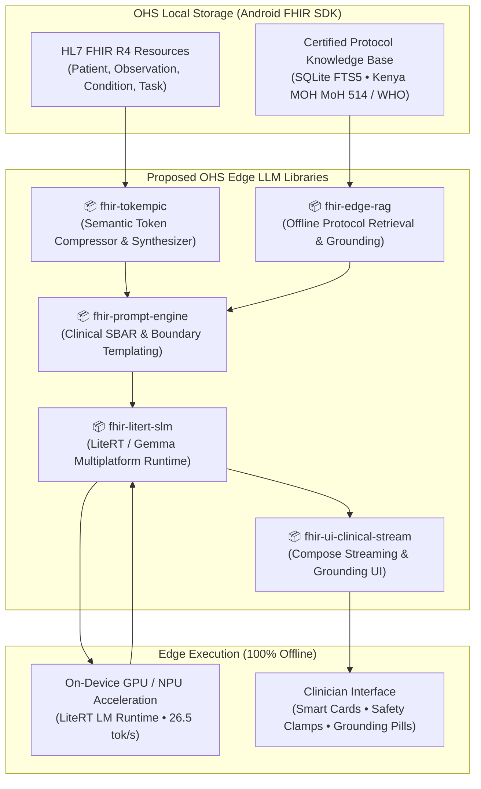

# Community RFC / Proposal: Enabling Offline Edge SLMs in the OHS Foundation Repositories

**Document ID:** OHS-RFC-2026-01  
**Category:** Architecture & Foundation Libraries  
**Status:** Proposed / Community Discussion  
**Target Organization:** Open Health Stack Foundation (`github.com/ohs-foundation`)  
**Target Repositories:** `ohs-foundation/android-fhir` or new `ohs-foundation/fhir-edge-ai`  
**Maven Artifact Group:** `dev.ohs.fhir:*` (aligning with `dev.ohs.fhir:fhir-model-r4`)  
**Authors:** OHS Edge SLM Working Group  
**Target Environment:** 100% Offline Primary Healthcare (Community Health Promoters, Midwives, Rural Clinics)

---

## 1. Executive Summary

Digital health tools built on the **Open Health Stack (OHS) Foundation** libraries (`dev.ohs.fhir:fhir-model-r4`, `ohs-foundation/android-fhir`) power frontline care for millions of patients across low- and middle-income countries (LMICs). However, healthcare workers in rural and last-mile environments frequently operate without cellular connectivity or cloud access.

Recent breakthroughs in on-device **Small Language Models (SLMs)**—specifically **Gemma 4 E2B** and **Gemma 2B** running on Google LiteRT—now make it feasible to execute clinical intelligence directly on standard $150–$250 consumer smartphones. 

During empirical evaluation and field-prototyping on a physical device (**CMF Phone 1**, MediaTek Dimensity 7300, Mali-G615 GPU, 8 GB RAM), we achieved **26.5 tokens/second throughput** and **240 ms time-to-first-token** in **100% offline flight mode**.

However, deploying edge SLMs with FHIR at scale revealed four critical infrastructural gaps:
1. **Token Inflation:** Raw HL7 FHIR R4 JSON bundles consume ~1,150 tokens for a basic ANC encounter, exhausting edge SLM context windows.
2. **Clinical Hallucination Risk:** Unconstrained SLMs risk recommending unverified or dangerous treatments without strict protocol grounding.
3. **Runtime Fragmentation:** Integrating on-device acceleration (GPU/NPU delegates via LiteRT) requires repetitive, fragile native boilerplate.
4. **Frontline UX & Stream Parsing:** Raw model streaming produces fragmented markdown and lack of visual risk stratification for community health workers (CHWs).

To resolve these barriers, we propose **5 modular, open-source Kotlin Multiplatform (KMP) libraries** to be contributed to the **`ohs-foundation`** repositories.

---

## 2. Real-World Physical Device Benchmarks

All architectural choices in this proposal are grounded in empirical benchmarking conducted on physical hardware:

| Parameter | Observed Performance (CMF Phone 1) | Target Threshold |
| :--- | :--- | :--- |
| **Model** | Gemma 4 E2B (Int4 Quantized LiteRT LM) | ≤ 2.5 Billion parameters |
| **Offline Mode** | **100% Offline** (Zero network / Airplane mode) | Mandatory for last-mile CHWs |
| **Inference Hardware** | Mali-G615 GPU (OpenCL/Vulkan LiteRT Delegate) | Hardware accelerated |
| **Generation Speed** | **26.5 tokens / second** | > 15 tokens / second |
| **Time-to-First-Token (TTFT)** | **~240 milliseconds** | < 1,000 milliseconds |
| **Model Memory Footprint** | **1.38 GB RAM** (Peak) | < 2.0 GB RAM (on 6–8 GB phones) |
| **FHIR Token Compression** | **1,150 tokens ➔ 320 tokens (~72% savings)** | > 60% reduction |
| **Protocol Retrieval Speed** | **0.4 ms** (SQLite FTS5, 20 Certified CDUs) | < 10 ms |

---

## 3. Architecture Overview



---

## 4. Proposed Foundation Libraries

### Library 1: `dev.ohs.fhir:fhir-tokempic`
**Semantic FHIR-to-SLM Token Compressor & Tabular Synthesizer**

* **Core Responsibility:** Converts verbose HL7 FHIR R4 JSON into high-density tabular markdown optimized for edge language models.
* **Key Features:**
  * Compresses multi-resource bundles (`Patient`, `Condition`, `Observation`, `Task`, `Encounter`) from **~1,150 tokens down to ~320 tokens (~72% reduction)**.
  * Preserves critical clinical semantics: separates active diagnoses from resolved past history, normalizes LOINC vital panels, and extracts urgency flags.
  * Standardized tabular syntax (`## demographics`, `## active conditions`, `## vitals & observations`, `## urgent alerts & tasks`).
* **KMP Support:** Android, JVM, iOS (Kotlin Multiplatform).

```markdown
## Sample Tokempic Output (~80 tokens vs. ~420 tokens raw FHIR):
## demographics
Fatima Bello | Age: 28y (DOB: 1998-04-12) | female | Koro Village

## active conditions
Pregnancy 32 weeks | active | 2026-03-01
Pregnancy-induced hypertension | active | 2026-09-15

## vitals & observations
2026-10-14 | Blood Pressure | 148/96 mmHg | High
2026-10-14 | Urine Protein Dipstick | 1+ | Abnormal

## urgent alerts & tasks
[urgent] Refer to District Hospital for pre-eclampsia | Due: 2026-10-16
```

---

### Library 2: `dev.ohs.fhir:fhir-edge-rag`
**Offline Protocol Retrieval & Deterministic Grounding Engine**

* **Core Responsibility:** Guarantees zero-hallucination clinical decision support by deterministically retrieving national protocol decision units and injecting them directly into the inference context.
* **Key Features:**
  * **Ultra-Lightweight Storage:** Uses pre-indexed SQLite FTS5 with BM25 ranking (no vector embeddings required; sub-megabyte database footprint; <1ms search time).
  * **Certified Clinical Decision Units (CDUs):** Formats national guideline manuals (e.g., Kenya MOH eCHIS MoH 514, WHO SMART Guidelines) into modular units containing:
    1. Entry criteria (e.g., `Systolic BP >= 140 or Diastolic >= 90 after 20 weeks`)
    2. Danger signs (e.g., severe headache, visual disturbances)
    3. Mandated referral actions
    4. Explicit **Negative Boundaries** (e.g., *"Strictly FORBID digital vaginal examination in antepartum hemorrhage"* or *"Do NOT prescribe home antihypertensives"*).
  * **Automatic Case Matching:** Binds active patient conditions and observations to corresponding guidelines without manual query drafting.

---

### Library 3: `dev.ohs.fhir:fhir-litert-slm`
**Idiomatic Android & KMP Runtime for Google LiteRT / Gemma**

* **Core Responsibility:** Abstracts native on-device LLM loading, hardware delegate selection, token streaming, and memory safety into idiomatic Kotlin Coroutines.
* **Key Features:**
  * Coroutine-native streaming API:
    ```kotlin
    val engine = FhirEdgeLlmEngine(context, config = Gemma4E2BConfig)
    engine.generateStream(prompt).collect { token ->
        // Real-time token emission
    }
    ```
  * Automatic hardware delegate management (Mali/Adreno OpenCL/Vulkan GPU with fallback to multi-threaded CPU).
  * Built-in telemetry collector: Real-time time-to-first-token (TTFT), tokens/second throughput, and RSS RAM monitoring.
  * Model discovery provider: Safely resolves quantized `.bin` or `.tflite` model files from internal app assets, scoped storage, or external SD cards.

---

### Library 4: `dev.ohs.fhir:fhir-prompt-engine`
**Standardized Clinical Prompt & Safety Guardrail Templating**

* **Core Responsibility:** Provides validated, safety-tested clinical prompt structures designed specifically for primary care workers.
* **Key Features:**
  * **Pre-Visit Briefing Template:** Formats encounter history into concise **3-bullet SBAR summaries** (Situation, Background, Assessment/Recommendation).
  * **Protocol Triage Template:** Injects active Tokempic records, retrieved protocol chunks, and CHW questions with mandatory citation tagging (`[Grounded in Protocol § ID]`).
  * **Negative Boundary Enforcer:** Automatically constructs safety clauses preventing common edge mistakes (e.g., treating resolved malaria, administering contraindicated medications).

---

### Library 5: `dev.ohs.fhir:fhir-ui-clinical-stream`
**Jetpack Compose Clinical Streaming & Grounding Components**

* **Core Responsibility:** Frontline UI library that converts streaming text into structured, elevated clinical cards with dynamic risk highlighting and transparent citations.
* **Key Features:**
  * **Real-Time Markdown Cleaner:** Strips unparsed syntax (`**`, `#`, unfinished bullets) during token generation to prevent visual stutter.
  * **Dynamic Risk Stratification:**
    * 🔴 **Critical Alerts (`#DC2626` / `#FEF2F2`):** Emergency referrals, BP ≥ 140/90, severe anemia (Hb < 7.0), antepartum bleeding.
    * 🟡 **Clinical Warnings (`#D97706` / `#FFFBEB`):** Proteinuria, tachycardia, overdue visits.
    * 🔵 **Protocol Directions (`#1D4ED8` / `#EFF6FF`):** Hospital destinations, contraindication rejections.
  * **Grounded Protocol Citation Cards:** Displays official source stamps (`Kenya MOH eCHIS • MoH 514`), verbatim rule excerpts, and one-tap audit navigation into the protocol database.
  * **Line-by-Line Grounding Badges:** Renders emerald badges (`🌿 Grounded in MNH-02 § ANC-04`) directly beside recommendation points.

---

## 5. Clinical Safety & Guardrail Architecture

Safety is the foremost design requirement for offline generative models in healthcare. The proposed stack enforces **three redundant safety layers**:

```
[Layer 1: Deterministic Data Filtering]
   └── Tokempic isolates resolved conditions from active conditions (e.g. "Malaria resolved 2025").

[Layer 2: Protocol Negative Boundaries]
   └── Mini-RAG injects hard safety clamps (e.g. "NEVER perform digital vaginal examination").

[Layer 3: UI-Level Grounding Verification]
   └── fhir-ui-clinical-stream verifies presence of citation tags before rendering verified badges.
```

---

## 6. Implementation Plan & Phased Roadmap

* **Phase 1 (Months 1–2):**
  * Release `fhir-tokempic` (`dev.ohs.fhir:fhir-tokempic`) as an independent Kotlin Multiplatform module within the `ohs-foundation` organization.
  * Validate token compression ratios across synthetic Synthea, WHO ANC, and Kenya eCHIS patient bundles.
* **Phase 2 (Months 3–4):**
  * Release `fhir-edge-rag` (`dev.ohs.fhir:fhir-edge-rag`) with SQLite FTS5 indexing for WHO SMART Guidelines and national protocols.
  * Release `fhir-prompt-engine` (`dev.ohs.fhir:fhir-prompt-engine`) with standardized clinical SBAR templates.
* **Phase 3 (Months 5–6):**
  * Release `fhir-litert-slm` (`dev.ohs.fhir:fhir-litert-slm`) runtime adapter supporting Gemma 4 E2B and Gemma 2B.
  * Release `fhir-ui-clinical-stream` (`dev.ohs.fhir:fhir-ui-clinical-stream`) Jetpack Compose components.
  * Publish a full reference implementation app in `ohs-foundation/ohs-edge-demo`.

---

## 7. Community Feedback Requested

We invite feedback from the OHS Foundation community, Android developers, WHO SMART guidelines contributors, and digital health implementers:
1. **Repository Topology within `ohs-foundation`:**
   * **Option A (Dedicated AI Repo):** Create a unified multi-module repository `ohs-foundation/fhir-edge-ai` hosting all 5 modules (`tokempic`, `edge-rag`, `litert-slm`, `prompt-engine`, `ui-clinical-stream`).
   * **Option B (Core Monorepo Modules):** Integrate `tokempic`, `edge-rag`, and `inference` as sub-modules directly inside `ohs-foundation/android-fhir` alongside `engine`, `data-capture`, and `workflow`.
2. **Standard Alignment:** Does the CDU schema in `fhir-edge-rag` map cleanly to WHO SMART Guidelines (L3 machine-readable guidelines) and existing FHIR `PlanDefinition` / `ActivityDefinition` resources?
3. **Model Support:** In addition to Google Gemma 4 E2B / Gemma 2B via LiteRT, should the runtime support additional edge backends (e.g. ExecuTorch for Llama 3.2 1B/3B, ONNX Runtime for Phi-3.5 mini)?

---

*Join the discussion on the Open Health Stack Foundation GitHub Discussions (`ohs-foundation`) or submit comments via PR on this RFC.*
